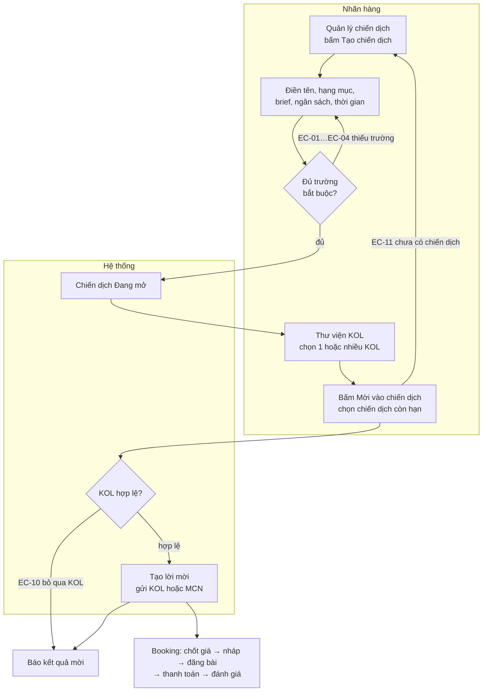

# Tạo chiến dịch Booking KOL và mời KOL

| Mục | Giá trị |
|---|---|
| **Sản phẩm** | KOL Hub — sàn kết nối Nhãn hàng/Agency với KOL/MCN |
| **Vai trò** | Nhãn hàng/Agency |
| **Mã nghiệp vụ gốc** | Chưa có mã chính thức · tạm dùng QĐ-C01…QĐ-C05 (mục 0) và SPEC-BK §x (spec `docs/superpowers/specs/2026-09-29-kolhub-campaign-booking-beta-design.md`) |
| **Nguồn đặc tả** | Quyết định của anh Trọng ngày 08/10/2026 · SPEC-BK · prototype `src/app/features/campaigns`, `src/app/services/mock/campaign*.ts` |
| **Phiên bản** | Draft v0.1 · 08/10/2026 |

Nhãn hàng **tạo chiến dịch trước**, rồi vào thư viện KOL **mời một hoặc nhiều KOL** vào chiến dịch đó. Tài liệu này mô tả form tạo chiến dịch Booking KOL đã rút gọn (chỉ hiện trường bắt buộc, phần còn lại gộp vào "Tính năng nâng cao") và luồng mời KOL. Khác với chiến dịch **Tuyển nhiều KOL**: loại đó do KOL/MCN tự ứng tuyển trên Sàn, không mời riêng, và vẫn dùng form đầy đủ.

> ⚠️ **Cần BA xác nhận:** Trụ và mã nghiệp vụ chính thức của tính năng.

## 0. Quyết định gốc

**Mã nghiệp vụ gốc:** QĐ-C01…QĐ-C05

| Mã | Quyết định (nguyên văn) | Giờ |
|---|---|---|
| QĐ-C01 | "brand tạo chiến dịch trước, khi vào thu viện KOL bấm mời kol sổ ra những chiến dịch còn hạn brand đang tạo, chọn chiến dịch" | 17:08 |
| QĐ-C02 | "brand có thể mời nhiều kol 1 lúc" | 17:08 |
| QĐ-C03 | "nhưng chỉ được chọn kol" | 17:09 |
| QĐ-C04 | "với uông chiến dịch 1 kol phân tích xem các đầu mục hiẹn tại ưu tiên hiển thị ra những trường bắt buộc và tạo flow đơn giản nhất, những mục còn lại gộp chung vào tính năng nâng cao" | 17:10 |
| QĐ-C05 | "Brief có chuyển thành bắt buộc, Chiến dịch Booking KOL có cho đăng lên Sàn" | 17:13 |

## 1. Tổng quan luồng

**Mã nghiệp vụ gốc:** QĐ-C01, QĐ-C02 · SPEC-BK §3, §4, §5

| | Booking KOL (tài liệu này) | Tuyển nhiều KOL |
|---|---|---|
| Ai khởi động | Nhãn hàng mời KOL | KOL/MCN ứng tuyển trên Sàn |
| Giá | Thoả thuận từng booking | Phần thưởng cố định |
| Form tạo | Rút gọn: 3 khối chính + Tính năng nâng cao | Form đầy đủ (không đổi) |
| Mời riêng KOL | Có | Không |
| Đăng lên Sàn | Tuỳ chọn (trong Tính năng nâng cao) | Luôn trên Sàn |

## 2. Tạo chiến dịch Booking KOL

**Mã nghiệp vụ gốc:** QĐ-C04, QĐ-C05 · SPEC-BK §3

**Ai làm:** Nhãn hàng/Agency đã xác thực email công ty · **Tiền điều kiện:** Đang ở Quản lý chiến dịch

### Bố cục form

| Thứ tự | Khối | Trường | Bắt buộc khi đăng |
|---|---|---|---|
| 1 | Tên chiến dịch | Tên (tiêu đề form) | Có |
| 2 | Loại chiến dịch | Booking riêng / Tuyển nhiều KOL | Có (mặc định Booking riêng) |
| 3 | Nội dung cần làm | Hạng mục: loại nội dung, nền tảng, số lượng (thêm được nhiều dòng) | Có, ít nhất 1 dòng |
| 3 | Nội dung cần làm | Brief | Có |
| 4 | Ngân sách và thời gian | Ngân sách (VND) | Có |
| 4 | Ngân sách và thời gian | Ngày bắt đầu, ngày kết thúc | Có |
| 5 | Tính năng nâng cao (gập) | Xem mục 3 | Không |

### Luồng chính

| Bước | Màn hình | Người dùng làm | Hệ thống phản hồi |
|---|---|---|---|
| 1 | Quản lý chiến dịch | Bấm "Tạo chiến dịch" | Mở form, loại mặc định Booking riêng, Tính năng nâng cao đang gập |
| 2 | Form tạo chiến dịch | Đặt tên chiến dịch | Mở nút "Lưu nháp" và "Đăng chiến dịch" |
| 3 | Form tạo chiến dịch | Thêm hạng mục, chọn loại, nền tảng, số lượng | Dòng mới lấy nền tảng của dòng trước (TikTok nếu là dòng đầu) |
| 4 | Form tạo chiến dịch | Nhập brief, ngân sách, ngày bắt đầu, ngày kết thúc | — |
| 5 | Form tạo chiến dịch | Bấm "Đăng chiến dịch" | Kiểm trường bắt buộc · lỗi → EC-01, EC-02, EC-03, EC-04 · đủ thì chiến dịch Đang mở, chuyển sang trang chi tiết chiến dịch |
| 5a | Form tạo chiến dịch | Hoặc bấm "Lưu nháp" | Lưu Bản nháp, chỉ cần có tên |

### Quy tắc

| ID | Quy tắc | Điều kiện áp dụng | Nguồn |
|---|---|---|---|
| BR-01 | Chiến dịch phải được tạo trước khi mời KOL | Mọi lời mời | QĐ-C01 |
| BR-02 | Form chỉ hiện 3 khối chính (Nội dung cần làm, Ngân sách và thời gian, cùng tên và loại chiến dịch); các mục còn lại gộp vào "Tính năng nâng cao" | Loại Booking riêng | QĐ-C04 |
| BR-03 | Điều kiện đăng: có tên, ít nhất 1 hạng mục, brief không trống, ngân sách > 0, ngày bắt đầu không sau ngày kết thúc, ngày kết thúc chưa qua | Bấm "Đăng chiến dịch" | QĐ-C05 · SPEC-BK §3 |
| BR-04 | Brief bắt buộc cả khi sửa chiến dịch đang mở: xoá trống brief thì không lưu được | Chiến dịch Đang mở | QĐ-C05 · SPEC-BK §3 |
| BR-05 | Lưu nháp chỉ cần tên | Bản nháp | SPEC-BK §3 |
| BR-06 | Không có ô chọn nền tảng riêng: nền tảng của chiến dịch là tập nền tảng của các hạng mục | Loại Booking riêng | QĐ-C04 · ⚠️ chưa rõ (đề xuất, đã làm trên prototype) |
| BR-07 | Tên tối đa 150 ký tự; brief và mục tiêu tối đa 5.000 ký tự; số lượng mỗi hạng mục từ 1 đến 100 | Mọi chiến dịch | SPEC-BK §3 · prototype |
| BR-08 | Đăng thành công: chiến dịch chuyển Đang mở; nếu Riêng tư thì báo "Chiến dịch đang mở. Hãy mời KOL để bắt đầu." | Bấm "Đăng chiến dịch" | prototype |
| BR-09 | Chiến dịch Tuyển nhiều KOL giữ form đầy đủ như cũ; brief của loại này vẫn không bắt buộc | Loại Tuyển nhiều KOL | QĐ-C04 |

> ⚠️ **Cần BA xác nhận:** Ngân sách có còn bắt buộc không. Khi mời, Nhãn hàng đã nhập giá cho từng KOL, còn ngân sách tổng hiện chỉ để Nhãn hàng tự theo dõi: hệ thống không chặn khi tổng giá các booking vượt ngân sách. Prototype đang giữ ngân sách là bắt buộc.

> ⚠️ **Cần BA xác nhận:** Có tách lối vào riêng "Booking KOL" và "Tuyển nhiều KOL" ngay từ nút Tạo chiến dịch để bỏ khối chọn loại khỏi form không. Prototype hiện vẫn giữ khối "Loại chiến dịch" ở đầu form.

### Ngoại lệ và lỗi

| ID | Trường hợp | Hành vi mong đợi | Thông báo hiển thị |
|---|---|---|---|
| EC-01 | Brief trống khi đăng hoặc khi sửa chiến dịch đang mở | Không đăng/không lưu, cuộn tới ô Brief | Brief không hợp lệ hoặc còn trống. Brief bắt buộc khi đăng chiến dịch Booking riêng, tối đa 5.000 ký tự. |
| EC-02 | Chưa có hạng mục nào | Không đăng, cuộn tới khối hạng mục | Nền tảng không hợp lệ hoặc còn trống. Cần ít nhất một hạng mục nội dung (nền tảng lấy theo hạng mục). |
| EC-03 | Ngân sách trống hoặc bằng 0 | Không đăng, cuộn tới ô Ngân sách | Ngân sách không hợp lệ hoặc còn trống. Nhập ngân sách lớn hơn 0 để đăng chiến dịch. |
| EC-04 | Thiếu ngày, ngày bắt đầu sau ngày kết thúc, hoặc ngày kết thúc đã qua | Không đăng, cuộn tới ô ngày | Thời gian chạy không hợp lệ hoặc còn trống. Cần ngày bắt đầu và ngày kết thúc; ngày kết thúc không trước ngày bắt đầu và chưa qua. |
| EC-05 | Tài khoản không phải Nhãn hàng đã xác thực email công ty | Chặn | Tính năng này chỉ dành cho tài khoản Nhãn hàng/Agency đã xác thực email công ty. |

> ⚠️ **Cần BA xác nhận:** EC-02 bắt đầu bằng "Nền tảng không hợp lệ…" vì dịch vụ báo lỗi ở trường Nền tảng. Form Booking không còn ô Nền tảng nên câu này dễ gây hiểu nhầm. Đề xuất đổi phần đầu thành "Hạng mục nội dung không hợp lệ hoặc còn trống."

## 3. Tính năng nâng cao

**Mã nghiệp vụ gốc:** QĐ-C04, QĐ-C05 · SPEC-BK §3

Khối gập sẵn ở cuối form. Khi gập hiện một dòng tóm tắt thiết lập hiện tại, ví dụ "Riêng tư · Đàm phán: bật · Duyệt nháp: bật · Hợp đồng: bật".

| Mục | Mặc định | Tác dụng |
|---|---|---|
| Mục tiêu | Trống | Mô tả mục tiêu chiến dịch |
| Hiển thị | Riêng tư | Riêng tư: chỉ KOL/MCN được mời thấy. Trên Sàn chiến dịch: KOL/MCN đã duyệt xem và gửi đề xuất, Nhãn hàng vẫn mời thêm được |
| Hạn ứng tuyển | Trống | Chỉ hiện khi chọn Trên Sàn. Trống = nhận đề xuất đến ngày kết thúc |
| Lĩnh vực | Trống | Chỉ hiện khi chọn Trên Sàn. Giúp KOL/MCN trên Sàn tìm thấy chiến dịch |
| Đàm phán | Bật | Tắt: giá cố định, KOL/MCN chỉ chấp nhận hoặc từ chối, lời mời phải kèm giá |
| Duyệt nháp | Bật | Tắt: KOL đăng bài thẳng rồi gửi link, không qua duyệt nháp |
| Sự tuân thủ | Tắt | Bật để nhập quy định nội dung (hashtag, ghi nhãn quảng cáo…) |
| Hợp đồng | Bật, kèm 2 điều khoản mặc định | Điều khoản KOL/MCN phải đồng ý; tệp hợp đồng đính kèm trong từng booking |
| Điều kiện tham gia | Tắt | Chỉ hiện khi chọn Trên Sàn |
| Câu hỏi khảo sát | Tắt | Chỉ hiện khi chọn Trên Sàn |
| Ảnh chiến dịch | Không có | JPG, PNG hoặc WebP, tối đa 10 MB; hiện trên thẻ chiến dịch ở Sàn |

### Quy tắc

| ID | Quy tắc | Điều kiện áp dụng | Nguồn |
|---|---|---|---|
| BR-10 | Khối Tính năng nâng cao gập mặc định và hiện dòng tóm tắt thiết lập hiện tại | Loại Booking riêng | QĐ-C04 |
| BR-11 | Chiến dịch Booking KOL được đăng lên Sàn chiến dịch, chọn ở mục Hiển thị | Loại Booking riêng | QĐ-C05 |
| BR-12 | Hạn ứng tuyển, Lĩnh vực, Điều kiện tham gia, Câu hỏi khảo sát chỉ hiện khi chọn Trên Sàn chiến dịch | Loại Booking riêng | QĐ-C05 · ⚠️ chưa rõ (đề xuất, đã làm) |
| BR-13 | Chiến dịch Riêng tư không lưu điều kiện tham gia và câu hỏi khảo sát, vì không có ai ứng tuyển | Lưu chiến dịch Riêng tư | ⚠️ chưa rõ (đề xuất, đã làm) |
| BR-14 | Có lỗi ở một trường nằm trong khối nâng cao thì khối tự mở và cuộn tới trường đó | Đăng hoặc lưu bị lỗi | prototype |
| BR-15 | Không hiện thẻ "Đề nghị trả phí" và "Tặng quà" với chiến dịch Booking riêng | Loại Booking riêng | QĐ-C04 |
| BR-16 | Điều khoản hợp đồng mặc định: "Giữ bài đăng ở chế độ công khai tối thiểu 6 tháng." và "Cho phép Nhãn hàng dùng lại bài đăng để quảng bá trên kênh của Nhãn hàng." | Bật Hợp đồng | prototype |

### Ngoại lệ và lỗi

| ID | Trường hợp | Hành vi mong đợi | Thông báo hiển thị |
|---|---|---|---|
| EC-06 | Hạn ứng tuyển sau ngày kết thúc hoặc đã qua | Không đăng, mở khối nâng cao, cuộn tới ô | Hạn ứng tuyển không hợp lệ hoặc còn trống. Hạn ứng tuyển không được sau ngày kết thúc và chưa qua. |
| EC-07 | Ảnh sai định dạng hoặc quá 10 MB | Không nhận ảnh | Ảnh chiến dịch phải là JPG, PNG hoặc WebP, tối đa 10 MB. |

## 4. Mời KOL vào chiến dịch

**Mã nghiệp vụ gốc:** QĐ-C01, QĐ-C02, QĐ-C03 · SPEC-BK §4, §5

**Ai làm:** Nhãn hàng/Agency · **Tiền điều kiện:** Có ít nhất một chiến dịch Booking riêng còn hạn

### Luồng chính

| Bước | Màn hình | Người dùng làm | Hệ thống phản hồi |
|---|---|---|---|
| 1 | Thư viện KOL (Tìm kiếm KOL) · Hồ sơ KOL · Danh sách đã lưu | Chọn một KOL, hoặc tick nhiều KOL | — |
| 2 | Như trên | Bấm "Mời vào chiến dịch" | Mở hộp "Mời vào chiến dịch" với danh sách chiến dịch còn hạn · lỗi → EC-11 |
| 3 | Hộp Mời vào chiến dịch | Chọn chiến dịch, hạng mục, nhập giá cho mỗi KOL (tuỳ chọn), lời nhắn (tuỳ chọn) | Chiến dịch Bản nháp hiện lưu ý sẽ được đăng khi gửi lời mời |
| 4 | Hộp Mời vào chiến dịch | Bấm "Gửi lời mời" | Tạo lời mời cho từng KOL hợp lệ · lỗi → EC-08, EC-09, EC-10, EC-12 |
| 5 | Hộp Kết quả mời | Xem kết quả, bấm "Xem chiến dịch" hoặc "Xong" | Liệt kê lời mời mới, lời mời được bổ sung KOL và KOL bị bỏ qua kèm lý do |

### Quy tắc

| ID | Quy tắc | Điều kiện áp dụng | Nguồn |
|---|---|---|---|
| BR-17 | Nút "Mời vào chiến dịch" có ở thư viện KOL, hồ sơ KOL và Danh sách đã lưu | Nhãn hàng | QĐ-C01 · prototype |
| BR-18 | Danh sách chiến dịch trong hộp mời chỉ gồm chiến dịch Booking riêng của chính Nhãn hàng, ở trạng thái Bản nháp, Đang mở hoặc Đang chạy, và **ngày kết thúc chưa qua** | Mở hộp mời | QĐ-C01 · SPEC-BK §4 |
| BR-19 | Mời được nhiều KOL trong một lần, ở cả thư viện KOL và Danh sách đã lưu | Chọn nhiều KOL | QĐ-C02 |
| BR-20 | Đơn vị chọn là KOL. Nhãn hàng không chọn kênh, không chọn MCN; hệ thống tự gán kênh hợp lệ cùng nền tảng của hạng mục và tự chuyển lời mời sang MCN nếu KOL đang giữ kênh của MCN đã duyệt | Gửi lời mời | QĐ-C03 · SPEC-BK §4 |
| BR-21 | Một lượt mời dùng chung một chiến dịch, một hạng mục, một mức giá cho mỗi KOL và một lời nhắn. Muốn giá khác nhau thì mời thành nhiều lượt | Gửi lời mời | prototype |
| BR-22 | Giá bỏ trống = "chờ báo giá": KOL/MCN phải báo giá trước khi chốt. Đàm phán tắt thì giá bắt buộc | Gửi lời mời | SPEC-BK §4 · prototype |
| BR-23 | Mời từ chiến dịch Bản nháp thì chiến dịch tự đăng (Đang mở) nếu đã đủ điều kiện đăng (BR-03) | Chiến dịch Bản nháp | SPEC-BK §3 |
| BR-24 | KOL đã có lời mời hoặc booking đang hoạt động trong chiến dịch, hoặc không còn hiển thị trong tìm kiếm, thì bị bỏ qua và báo lý do; các KOL khác vẫn được mời | Gửi lời mời | SPEC-BK §4 |
| BR-25 | Nhiều KOL cùng một MCN được gom vào lời mời đang chờ của MCN đó trong chiến dịch | Lời mời của MCN còn ở trạng thái chờ | SPEC-BK §4 |
| BR-26 | Lời mời hết hạn sau 7 ngày nếu KOL/MCN chưa phản hồi | Lời mời chưa phản hồi | SPEC-BK §5 |
| BR-27 | Kênh được tự gán phải đã xác thực, còn hạn và đang hoạt động (xem tài liệu Xác thực kênh bằng KOL Safety, BR-36) | Gửi lời mời | `xac-thuc-kenh-kol-safety.md` |

> ⚠️ **Cần BA xác nhận — prototype chưa đáp ứng BR-18:** hộp mời hiện liệt kê mọi chiến dịch Bản nháp, Đang mở, Đang chạy, **kể cả chiến dịch đã qua ngày kết thúc**, và vẫn mời được vào chiến dịch đó. Cần thêm điều kiện ngày kết thúc chưa qua ở cả danh sách lẫn tầng dịch vụ. Đề xuất xếp chiến dịch sắp hết hạn lên đầu, kèm "còn N ngày".

> ⚠️ **Cần BA xác nhận — prototype chưa đáp ứng BR-19:** chọn nhiều KOL hiện chỉ có ở Danh sách đã lưu. Thư viện KOL (Tìm kiếm KOL) chỉ mời được từng KOL. Đề xuất thêm ô chọn trên thẻ/dòng KOL và thanh thao tác "Mời X KOL vào chiến dịch" giống Danh sách đã lưu.

> ⚠️ **Cần BA xác nhận:** BR-21. Có cần cho nhập giá riêng từng KOL trong cùng một lượt mời không. Prototype đang dùng chung một mức giá.

### Ngoại lệ và lỗi

| ID | Trường hợp | Hành vi mong đợi | Thông báo hiển thị |
|---|---|---|---|
| EC-08 | Đàm phán tắt mà chưa nhập giá, hoặc giá không hợp lệ | Khoá nút gửi; dịch vụ từ chối | Giá phải là số tiền lớn hơn 0 (VND). |
| EC-09 | Không có KOL nào được chọn | Không gửi | Vui lòng chọn ít nhất một KOL. |
| EC-10 | KOL bị bỏ qua | Vẫn mời các KOL còn lại, liệt kê KOL bị bỏ qua | Không tìm thấy KOL hoặc hồ sơ không còn hiển thị · KOL đã có trong chiến dịch |
| EC-11 | Nhãn hàng chưa có chiến dịch còn hạn | Hiện trạng thái trống và nút "Tạo chiến dịch" | Chưa có chiến dịch để mời · Tạo chiến dịch (bản nháp, đang mở hoặc đang chạy) rồi quay lại mời KOL. |
| EC-12 | Chiến dịch đã chuyển trạng thái (kết thúc, huỷ) trong lúc đang mời | Không gửi, yêu cầu tải lại | Chiến dịch không còn ở trạng thái cho phép thao tác này. Vui lòng tải lại. |

## 5. Trạng thái trên prototype

**Mã nghiệp vụ gốc:** QĐ-C01…QĐ-C05

| Hạng mục | Trạng thái | Ghi chú |
|---|---|---|
| Form Booking rút gọn: 3 khối chính + Tính năng nâng cao | Đã làm | `CampaignFormPage.tsx`, `FeatureCards.tsx` |
| Brief bắt buộc khi đăng và khi sửa chiến dịch đang mở | Đã làm | `campaignRules.ts` (`validateForOpen`), có test |
| Nền tảng lấy theo hạng mục | Đã làm | `campaignForm.ts` (`deliverablePlatforms`), có test |
| Điều kiện, khảo sát chỉ khi đăng lên Sàn | Đã làm | `campaignForm.ts` (`formToInput`), có test |
| Tuyển nhiều KOL giữ form đầy đủ | Không đổi | — |
| Hộp mời chỉ hiện chiến dịch còn hạn (BR-18) | **Chưa làm** | Xem khối Cần BA xác nhận ở mục 4 |
| Chọn nhiều KOL ở thư viện KOL (BR-19) | **Chưa làm** | Đã có ở Danh sách đã lưu |

## Tra cứu nhanh

| Hạng mục | Giá trị | Nguồn |
|---|---|---|
| Trường bắt buộc khi đăng (Booking riêng) | Tên, ít nhất 1 hạng mục, brief, ngân sách > 0, ngày bắt đầu, ngày kết thúc | BR-03 |
| Lưu nháp | Chỉ cần tên | BR-05 |
| Độ dài tên | Tối đa 150 ký tự | BR-07 |
| Độ dài brief, mục tiêu, quy định nội dung | Tối đa 5.000 ký tự | BR-07 |
| Số lượng mỗi hạng mục | 1–100 | BR-07 |
| Ảnh chiến dịch | JPG, PNG, WebP, tối đa 10 MB | EC-07 |
| Mặc định Tính năng nâng cao | Riêng tư · Đàm phán bật · Duyệt nháp bật · Hợp đồng bật (2 điều khoản) · Sự tuân thủ tắt | mục 3 |
| Chiến dịch hiện trong hộp mời | Booking riêng · Bản nháp, Đang mở, Đang chạy · ngày kết thúc chưa qua | BR-18 |
| Hạn phản hồi lời mời | 7 ngày | BR-26 |

### Nguồn tài liệu gốc

- Trao đổi với anh Trọng ngày 08/10/2026, 17:08–17:13 (QĐ-C01…QĐ-C05).
- `docs/superpowers/specs/2026-09-29-kolhub-campaign-booking-beta-design.md` (SPEC-BK) — §3 Chiến dịch, §4 Quy tắc định tuyến lời mời, §5 Booking.
- Prototype: `src/app/features/campaigns/CampaignFormPage.tsx`, `FeatureCards.tsx`, `campaignForm.ts`, `InviteToCampaignDialog.tsx`, `campaignView.ts`; `src/app/services/mock/campaignRules.ts`, `campaign.ts`; `src/app/services/errors.ts` (KOLHUB-4016, 4802, 4803, 4810, 4812).
- `docs/nghiep-vu/xac-thuc-kenh-kol-safety.md` — BR-36 (kênh hợp lệ khi booking).
