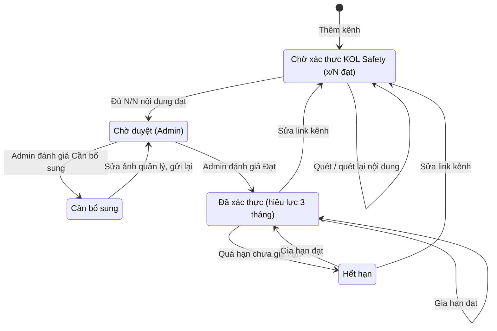
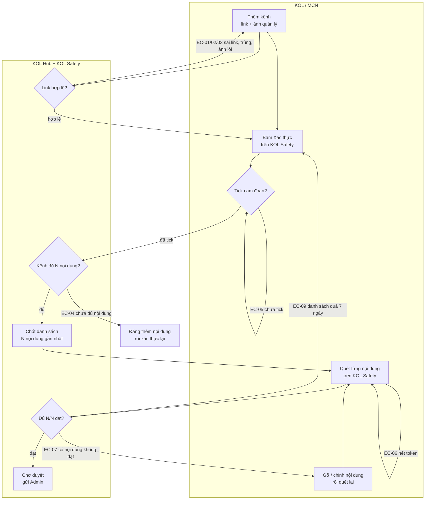
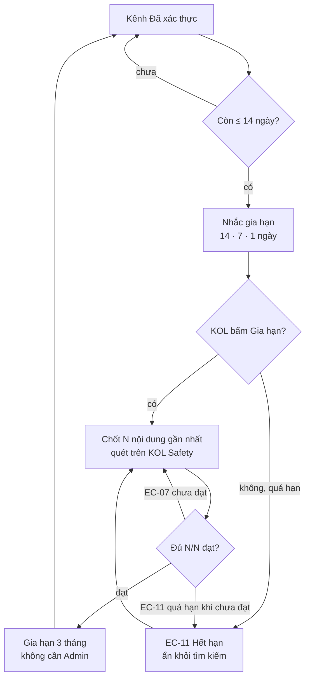

# Xác thực kênh bằng quét nội dung KOL Safety

| Mục | Giá trị |
|---|---|
| **Sản phẩm** | KOL Hub — sàn kết nối Nhãn hàng/Agency với KOL/MCN |
| **Hệ thống liên quan** | KOL Safety (quét vi phạm video ngắn và kênh) |
| **Mã nghiệp vụ gốc** | Chưa có mã chính thức · tạm dùng QĐ-01…QĐ-13 (mục 0) và mã NS-BR-xx (quy tắc của NS-KOLHUB-001) |
| **Nguồn đặc tả** | Quyết định của anh Trọng ngày 07/10/2026 · `docs/superpowers/specs/2026-10-07-kolhub-channel-safety-verification-design.md` · NS-KOLHUB-001 v1.0 · prototype `src/app/services` |
| **Phiên bản** | Draft v0.1 · 07/10/2026 |

Mỗi kênh mạng xã hội KOL/MCN khai trên KOL Hub phải **tự đạt chuẩn KOL Safety** mới được cấp dấu xác thực, và phải xác thực lại sau mỗi 3 tháng. Đây là xác thực **kênh**, khác với xét duyệt **hồ sơ tài khoản** (eKYC, thông tin liên hệ) đang có. Tính năng này thay cho "Khiên An toàn nội dung" và "Badge Xác thực Kol.gov.vn" cấp tài khoản ở bản R7 của prototype.

> ⚠️ **Cần BA xác nhận:** Trụ và mã nghiệp vụ chính thức của tính năng. Tài liệu đang dùng mã quyết định QĐ-xx ở mục 0 để truy vết.

## 0. Quyết định gốc

**Mã nghiệp vụ gốc:** QĐ-01…QĐ-13

Các quyết định dưới đây là nguồn của mọi quy tắc trong tài liệu, chép theo lời anh Trọng ngày 07/10/2026.

| Mã | Quyết định (nguyên văn) | Giờ |
|---|---|---|
| QĐ-01 | "1 user có thể có nhiều kênh, xác thực theo kênh chứ không xác thực tài khoản user" | 17:04 |
| QĐ-02 | "mỗi kênh bắt buộc phải đủ điều kiện mức video đạt chuẩn tối thiểu bên safety" | 17:04 |
| QĐ-03 | "với kênh tiktok 20 video gần nhất đạt tiêu chuẩn" | 17:35 |
| QĐ-04 | "với kênh fb và insta grame 20 nội dung (bao gồm tất cả nội dung như ảnh, bài viết, story, ghi chú) gần nhất đạt chuẩn" | 17:35 |
| QĐ-05 | "với youtube tối thiểu 5 video bao gôm vả ytb short và video thường" · "YouTube tính 5 video gần nhất" | 17:35 · 17:46 |
| QĐ-06 | "mối video chỉ quét tối đa 3 phút đầu" | 17:35 |
| QĐ-07 | "nếu những nội dung thuộc phút 4 trở đi safety sẽ không kiểm tra và chịu trách nhiệm" | 17:36 |
| QĐ-08 | "cho phép quét nhiều lần vì cơ chế token" | 17:36 |
| QĐ-09 | "Có làm Instagram trong đợt này" | 17:46 |
| QĐ-10 | "quét theo video chứ không quét cả kênh, bao giờ đủ số lượng video đạt yêu cầu mới cấp xác thực kênh" | 17:46 |
| QĐ-11 | "đơn vị token và ví token, thuộc nghiệp vụ của safety, tạm thời không cần quan tâm" | 17:46 |
| QĐ-12 | "mỗi 3 tháng yêu cầu xác thực lại safety để giữ xác thực như gia hạn visa" | 17:46 |
| QĐ-13 | "việc tiêu chí đạt nghiệp vụ bên kol safety, b chỉ cần quan tâm bây giờ tôi muốn bổ sung xác thực trên kol safety" | 14:45 |

## 1. Tổng quan và vòng đời kênh

**Mã nghiệp vụ gốc:** QĐ-01, QĐ-02, QĐ-10, QĐ-12 · NS-BR-15, NS-BR-23, NS-BR-24

### Xác thực hồ sơ khác xác thực kênh

| | Xét duyệt hồ sơ (tài khoản) | Xác thực kênh (tính năng này) |
|---|---|---|
| Đối tượng | Một tài khoản KOL hoặc MCN | Từng kênh TikTok / Facebook / Instagram / YouTube |
| Chứng minh điều gì | Người/tổ chức là thật | Kênh thuộc về chủ tài khoản **và** nội dung gần nhất đạt chuẩn KOL Safety |
| Điều kiện | Thông tin đủ, eKYC (MCN: GCN ĐKDN), cam đoan, Admin duyệt (NS-BR-64, NS-BR-65) | Đủ N nội dung gần nhất đạt KOL Safety + Admin duyệt chủ sở hữu kênh |
| Kết quả | KOL ID / MCN ID | Dấu xác thực trên kênh, hiệu lực 3 tháng |
| Hết hạn | Không | Có, xác thực lại mỗi 3 tháng |

### Vòng đời trạng thái kênh

### Quy tắc

| ID | Quy tắc | Điều kiện áp dụng | Nguồn |
|---|---|---|---|
| BR-01 | Xác thực KOL Safety gắn với từng kênh. Tài khoản không có trạng thái xác thực KOL Safety riêng | Mọi kênh của KOL và MCN | QĐ-01 |
| BR-02 | Kênh chỉ được cấp dấu xác thực khi đủ số nội dung gần nhất đạt chuẩn theo nền tảng (mục 2) | Mọi kênh | QĐ-02, QĐ-10 |
| BR-03 | Xác thực kênh áp dụng giống nhau cho kênh của KOL và kênh của MCN | Quản lý kênh dùng chung KOL/MCN | NS-BR-24 |
| BR-04 | Thêm trạng thái kênh **Chờ xác thực KOL Safety**. Các trạng thái Chờ duyệt, Cần bổ sung, Đã xác thực, Hết hạn giữ như hiện có | Mọi kênh | QĐ-10 · NS-BR-15 |
| BR-05 | Kênh đã đạt KOL Safety vẫn phải qua Admin duyệt chủ sở hữu (link + ảnh quản lý kênh) như hiện có | Lần xác thực đầu tiên, và sau khi sửa link kênh | NS-BR-15 · ⚠️ chưa rõ thứ tự |
| BR-06 | Công tắc Hoạt động của kênh độc lập với xác thực: kênh tắt vẫn giữ dấu nhưng ẩn khỏi tìm kiếm | Kênh đã xác thực | NS-BR-23 |

> ⚠️ **Cần BA xác nhận:** Thứ tự hai bước. Tài liệu đang đề xuất **đạt KOL Safety trước, Admin duyệt sau** để Admin không phải xem kênh chắc chắn trượt. Nguồn chưa nói thứ tự này.

> ⚠️ **Cần BA xác nhận:** Hồ sơ tài khoản có cần ít nhất 1 kênh đạt KOL Safety mới được gửi xét duyệt không. Lúc 14:42 anh nói "điều kiện để xác thực hồ sơ trên kolhub là điền đủ thông tin và có tối thiểu 10 video đạt tiêu chuẩn bên KOL safety", đến 17:04 lại chốt "xác thực theo kênh chứ không xác thực tài khoản user". Tài liệu đang hiểu theo câu 17:04: điều kiện gửi hồ sơ giữ nguyên NS-BR-64/NS-BR-65 ("Có ít nhất 1 kênh hoạt động kèm ảnh"), không cần kênh đạt KOL Safety.

## 2. Quy tắc nội dung được xét theo nền tảng

**Mã nghiệp vụ gốc:** QĐ-03, QĐ-04, QĐ-05, QĐ-06, QĐ-07, QĐ-09, QĐ-13

| Nền tảng | Nội dung được tính | Số nội dung xét (N) | Điều kiện đạt kênh | Phạm vi quét mỗi video |
|---|---|---|---|---|
| TikTok | Video | 20 gần nhất | Cả 20 đạt | 3 phút đầu |
| Facebook | Ảnh, bài viết, story, ghi chú | 20 gần nhất | Cả 20 đạt | 3 phút đầu |
| Instagram | Ảnh, bài viết, story, ghi chú | 20 gần nhất | Cả 20 đạt | 3 phút đầu |
| YouTube | Video thường và Shorts | 5 gần nhất | Cả 5 đạt | 3 phút đầu |

### Quy tắc

| ID | Quy tắc | Điều kiện áp dụng | Nguồn |
|---|---|---|---|
| BR-07 | Tiêu chí một nội dung "đạt" do KOL Safety quyết định. KOL Hub chỉ nhận kết quả Đạt / Không đạt và lý do, không tự chấm | Mọi nội dung | QĐ-13 |
| BR-08 | Nội dung xét luôn là N nội dung **mới nhất** của kênh. KOL không được tự chọn nội dung để quét | Mọi lần xác thực và gia hạn | QĐ-03, QĐ-04, QĐ-05 |
| BR-09 | Với Facebook và Instagram, mọi loại nội dung đều được tính vào 20 nội dung: ảnh, bài viết, story, ghi chú | Kênh Facebook, Instagram | QĐ-04 |
| BR-10 | Với YouTube, video thường và Shorts cùng được tính vào 5 video | Kênh YouTube | QĐ-05 |
| BR-11 | Mỗi video chỉ được quét tối đa 3 phút đầu | Mọi nội dung dạng video | QĐ-06 |
| BR-12 | Phần video từ phút thứ 4 trở đi KOL Safety không kiểm tra và không chịu trách nhiệm | Video dài hơn 3 phút | QĐ-07 |
| BR-13 | Instagram được hỗ trợ trong đợt này, ngang hàng Facebook, YouTube, TikTok | Thêm kênh, tìm kiếm, chiến dịch | QĐ-09 |

> ⚠️ **Cần BA xác nhận:** Story Facebook/Instagram tự mất sau 24 giờ. Nếu story nằm trong 20 nội dung gần nhất rồi hết hạn trong lúc KOL đang quét, nội dung đó có còn được tính không? Đề xuất xử lý ở BR-16.

## 3. Xác thực kênh lần đầu

**Mã nghiệp vụ gốc:** QĐ-02, QĐ-08, QĐ-10, QĐ-11 · NS-BR-20

**Ai làm:** KOL hoặc MCN có tài khoản · **Tiền điều kiện:** Kênh đã được thêm ở Quản lý kênh (link + ảnh quản lý kênh)

### Luồng chính

| Bước | Màn hình | Người dùng làm | Hệ thống phản hồi |
|---|---|---|---|
| 1 | Quản lý kênh | Thêm kênh: dán link, tải ảnh quản lý kênh | Nhận diện nền tảng TikTok / Facebook / Instagram / YouTube · kênh vào trạng thái Chờ xác thực KOL Safety · lỗi → EC-01, EC-02, EC-03 |
| 2 | Quản lý kênh | Bấm "Xác thực trên KOL Safety" | Hiện quy tắc của nền tảng (mục 2) và danh sách N nội dung gần nhất sẽ quét · lỗi → EC-04 |
| 3 | Hộp Xác thực trên KOL Safety | Tick ô cam đoan (mục 7), bấm mở KOL Safety | Chốt danh sách N nội dung tại thời điểm này · mở KOL Safety ở tab mới, đã đăng nhập sẵn, đúng kênh · lỗi → EC-05 |
| 4 | KOL Safety | Quét từng nội dung trong danh sách | KOL Safety trừ token và trả kết quả từng nội dung về KOL Hub · lỗi → EC-06, EC-07 |
| 5 | Quản lý kênh | Xem tiến độ "x/N nội dung đạt" | Cập nhật theo kết quả mới nhất · lỗi → EC-08 |
| 6 | Quản lý kênh | Nội dung không đạt: gỡ hoặc chỉnh trên nền tảng, rồi quét lại | Quét lại không giới hạn số lần · lỗi → EC-09 |
| 7 | — | — | Đủ N/N đạt → kênh chuyển Chờ duyệt, gửi Admin (mục 4) · thông báo cho KOL/MCN |

### Quy tắc

| ID | Quy tắc | Điều kiện áp dụng | Nguồn |
|---|---|---|---|
| BR-14 | Quét theo từng nội dung, không quét cả kênh một lần | Mọi lần xác thực và gia hạn | QĐ-10 |
| BR-15 | Được quét và quét lại không giới hạn số lần. Mỗi lần quét trừ token phía KOL Safety | Mọi nội dung | QĐ-08 |
| BR-16 | Danh sách N nội dung được chốt tại lúc KOL bấm mở KOL Safety. Nội dung đăng sau thời điểm đó không làm thay đổi danh sách. Danh sách chốt có hiệu lực 7 ngày | Lần xác thực và lần gia hạn | ⚠️ chưa rõ (đề xuất) |
| BR-17 | Kênh chỉ chuyển sang Chờ duyệt khi cả N nội dung trong danh sách chốt đều đạt | Mọi kênh | QĐ-10 |
| BR-18 | Đơn vị token, giá, ví token, nạp token do KOL Safety xử lý. KOL Hub không hiển thị và không tính token | Mọi lần quét | QĐ-11 |
| BR-19 | KOL Hub hiện nguyên văn lý do không đạt do KOL Safety trả về và đường dẫn tới báo cáo chi tiết trên KOL Safety | Nội dung không đạt | QĐ-13 |
| BR-20 | KOL không phải tạo tài khoản mới trên KOL Safety: KOL Hub mở KOL Safety đã đăng nhập sẵn, đúng kênh | Bước 3 | ⚠️ chưa rõ (đề xuất) |

> ⚠️ **Cần BA xác nhận:** BR-16 là đề xuất, cần KOL Safety đồng ý. Lý do đề xuất: story hết hạn sau 24 giờ và bài mới đăng liên tục, nếu danh sách "20 nội dung gần nhất" trượt theo thời gian thì KOL có thể không bao giờ quét đủ. Cần chốt: có chốt danh sách không, và hiệu lực 7 ngày có hợp lý không.

> ⚠️ **Cần BA xác nhận:** KOL Safety cấp danh sách N nội dung mới nhất bằng cách nào (tự đọc từ nền tảng hay KOL tự dán link từng nội dung). Nếu KOL tự dán link thì BR-08 (không được tự chọn) cần cơ chế kiểm tra.

> ⚠️ **Cần BA xác nhận:** BR-20 là đề xuất. Cách liên kết tài khoản KOL Hub với KOL Safety chưa được nêu.

### Ngoại lệ và lỗi

| ID | Trường hợp | Hành vi mong đợi | Thông báo hiển thị |
|---|---|---|---|
| EC-01 | Link không thuộc nền tảng hỗ trợ | Không thêm kênh | Chỉ hỗ trợ link kênh Facebook, YouTube hoặc TikTok. |
| EC-02 | Link kênh đã đăng ký trên KOL Hub | Không thêm kênh | Link kênh này đã được đăng ký trên KOL Hub. |
| EC-03 | Ảnh quản lý kênh sai định dạng hoặc quá 10 MB | Không lưu ảnh | Ảnh phải là JPG hoặc PNG, tối đa 10 MB. |
| EC-04 | Kênh có ít hơn N nội dung | Không mở KOL Safety, hướng dẫn đăng thêm nội dung | Đề xuất (chưa duyệt): Kênh cần ít nhất 20 nội dung. Đăng thêm rồi xác thực lại. |
| EC-05 | Chưa tick ô cam đoan | Không mở KOL Safety | |
| EC-06 | KOL hết token trên KOL Safety | KOL Safety xử lý (nạp token). KOL Hub không thay đổi trạng thái kênh | |
| EC-07 | Có nội dung không đạt | Kênh giữ Chờ xác thực KOL Safety, hiện số nội dung chưa đạt và lý do | Đề xuất (chưa duyệt): 3 nội dung chưa đạt. Gỡ hoặc chỉnh rồi quét lại. |
| EC-08 | KOL Hub chưa nhận được kết quả từ KOL Safety | Hiện nút Làm mới để hỏi lại KOL Safety | |
| EC-09 | Danh sách chốt quá 7 ngày mà chưa đủ N/N đạt | Bỏ danh sách cũ, KOL bấm xác thực lại để lấy danh sách mới | |

> ⚠️ **Cần BA xác nhận:** EC-01 hiện chỉ nêu "Facebook, YouTube hoặc TikTok" (thông báo KOLHUB-4202 đang dùng). Khi thêm Instagram (BR-13) cần câu thông báo mới. Câu đề xuất: "Chỉ hỗ trợ link kênh Facebook, Instagram, YouTube hoặc TikTok."

> ⚠️ **Cần BA xác nhận:** Kênh mới hoặc KOC nhỏ có ít hơn N nội dung sẽ không thể xác thực (EC-04). Chấp nhận chặn hoàn toàn, hay có ngoại lệ?

## 4. Admin duyệt chủ sở hữu kênh

**Mã nghiệp vụ gốc:** NS-BR-15, NS-BR-17

**Ai làm:** Admin vận hành KOL Hub · **Tiền điều kiện:** Kênh ở trạng thái Chờ duyệt (đã đủ N/N đạt KOL Safety)

### Luồng chính

| Bước | Màn hình | Người dùng làm | Hệ thống phản hồi |
|---|---|---|---|
| 1 | Console Admin | Mở kênh chờ duyệt | Hiện link, ảnh quản lý kênh, kết quả KOL Safety (N/N đạt, ngày quét) |
| 2 | Console Admin | Đánh giá Đạt | Kênh chuyển Đã xác thực · hiệu lực 3 tháng tính từ ngày duyệt · gửi email/SMS cho chủ kênh |
| 3 | Console Admin | Đánh giá Cần bổ sung, nhập lý do | Kênh chuyển Cần bổ sung, hiện lý do cho chủ kênh · lỗi → EC-10 |

### Quy tắc

| ID | Quy tắc | Điều kiện áp dụng | Nguồn |
|---|---|---|---|
| BR-21 | Admin chỉ xét chủ sở hữu kênh (link, ảnh quản lý). Admin không chấm lại nội dung KOL Safety đã chấm | Kênh Chờ duyệt | QĐ-13 · NS-BR-15 |
| BR-22 | Đánh giá Cần bổ sung bắt buộc nhập lý do | Kênh Chờ duyệt | NS-BR-15 |
| BR-23 | Kết quả duyệt được gửi cho chủ kênh qua email/SMS | Đạt hoặc Cần bổ sung | NS-BR-17 |
| BR-24 | Kênh Cần bổ sung sửa ảnh quản lý rồi gửi lại thì về Chờ duyệt, không phải quét KOL Safety lại. Sửa link kênh thì quay về Chờ xác thực KOL Safety | Kênh Cần bổ sung, Đã xác thực, Hết hạn | ⚠️ chưa rõ (đề xuất) |

> ⚠️ **Cần BA xác nhận:** BR-24. Prototype hiện quy định "sửa link/ảnh kênh có dấu → dấu tạm ngừng, kênh về PENDING_REVIEW" (Giả định câu 6). Cần chốt: sửa **ảnh** có bắt quét KOL Safety lại không (đề xuất: không), sửa **link** thì có (đề xuất: có, vì đã là kênh khác).

### Ngoại lệ và lỗi

| ID | Trường hợp | Hành vi mong đợi | Thông báo hiển thị |
|---|---|---|---|
| EC-10 | Admin chọn Cần bổ sung mà không nhập lý do | Không lưu đánh giá | |

## 5. Gia hạn xác thực kênh mỗi 3 tháng

**Mã nghiệp vụ gốc:** QĐ-12 · NS-BR-54, NS-BR-62 · KOLHUB-4809

**Ai làm:** KOL hoặc MCN chủ kênh · **Tiền điều kiện:** Kênh Đã xác thực sắp hết hạn, hoặc kênh Hết hạn

### Luồng chính

| Bước | Màn hình | Người dùng làm | Hệ thống phản hồi |
|---|---|---|---|
| 1 | — | — | Trước hạn 14, 7, 1 ngày: gửi thông báo trong app và email "Kênh sắp hết hạn xác thực" |
| 2 | Quản lý kênh | Bấm "Gia hạn" | Chốt danh sách N nội dung gần nhất tại thời điểm gia hạn (BR-16), mở KOL Safety · lỗi → EC-04, EC-05 |
| 3 | KOL Safety | Quét từng nội dung | Như mục 3 bước 4–6 · lỗi → EC-06, EC-07, EC-08, EC-09 |
| 4 | — | — | Đủ N/N đạt → gia hạn thêm 3 tháng, không cần Admin duyệt lại · thông báo cho chủ kênh |
| 5 | — | — | Quá hạn mà chưa gia hạn đạt → kênh Hết hạn · lỗi → EC-11 |

### Quy tắc

| ID | Quy tắc | Điều kiện áp dụng | Nguồn |
|---|---|---|---|
| BR-25 | Dấu xác thực kênh có hiệu lực 3 tháng | Kênh Đã xác thực | QĐ-12 |
| BR-26 | Gia hạn = xác thực lại KOL Safety trên N nội dung gần nhất **tại thời điểm gia hạn**, cùng quy tắc mục 2 | Kênh Đã xác thực hoặc Hết hạn | QĐ-12 · QĐ-03…QĐ-05 |
| BR-27 | Kênh Hết hạn bị ẩn khỏi Tìm kiếm KOL và Danh sách kênh, không được chọn khi ứng tuyển hay nhận lời mời | Kênh Hết hạn | NS-BR-54 · KOLHUB-4809 |
| BR-28 | KOL có kênh Hết hạn vẫn ở lại Danh sách đã lưu của Nhãn hàng, hiện trạng thái mới | Danh sách đã lưu | NS-BR-62 |
| BR-29 | Gia hạn mở từ khi kênh còn 14 ngày hiệu lực; nhắc ở các mốc 14, 7, 1 ngày | Kênh Đã xác thực | ⚠️ chưa rõ (đề xuất) |
| BR-30 | Gia hạn đạt thì không cần Admin duyệt lại, kể cả khi kênh đã Hết hạn (link kênh không đổi) | Gia hạn | ⚠️ chưa rõ (đề xuất) |
| BR-31 | Booking đã chốt trên kênh vẫn làm tiếp đến hoàn tất khi kênh Hết hạn; chỉ chặn booking mới | Booking ACCEPTED trở đi | ⚠️ chưa rõ (đề xuất) |
| BR-32 | Giữa hai lần gia hạn, KOL Hub không tự yêu cầu quét lại. Vi phạm phát sinh đi theo luồng Vi phạm hiện có (báo cáo → Admin xác nhận) | Kênh Đã xác thực | ⚠️ chưa rõ (đề xuất) |

> ⚠️ **Cần BA xác nhận:** "3 tháng" tính theo tháng lịch (07/10 → 07/01) hay cố định 90 ngày? Prototype đang để hạn dấu 365 ngày.

> ⚠️ **Cần BA xác nhận:** Gia hạn sớm (khi còn hạn) thì hạn mới **nối tiếp hạn cũ** (như gia hạn visa) hay **tính lại từ ngày gia hạn**? Đề xuất: nối tiếp hạn cũ, để KOL không bị thiệt khi gia hạn sớm.

> ⚠️ **Cần BA xác nhận:** Gia hạn sớm mà chưa đạt thì kênh **giữ dấu tới hết hạn cũ** hay mất dấu ngay? Đề xuất: giữ tới hết hạn cũ.

> ⚠️ **Cần BA xác nhận:** BR-32. Nguồn chỉ nói "mỗi 3 tháng yêu cầu xác thực lại". Chưa rõ trong thời gian còn hạn, KOL Safety có tự quét lại và báo kênh không còn đạt hay không.

### Ngoại lệ và lỗi

| ID | Trường hợp | Hành vi mong đợi | Thông báo hiển thị |
|---|---|---|---|
| EC-11 | Quá hạn mà chưa gia hạn đạt | Kênh chuyển Hết hạn, ẩn khỏi tìm kiếm, không nhận booking mới | |

## 6. Kênh đã xác thực trong tìm kiếm và booking

**Mã nghiệp vụ gốc:** QĐ-06, QĐ-07 · NS-BR-54, NS-BR-58 · KOLHUB-4809

**Ai làm:** Nhãn hàng/Agency xem · KOL/MCN dùng kênh trong booking · **Tiền điều kiện:** Kênh Đã xác thực còn hạn, đang hoạt động

### Quy tắc

| ID | Quy tắc | Điều kiện áp dụng | Nguồn |
|---|---|---|---|
| BR-33 | Tìm kiếm KOL chỉ hiện KOL có ít nhất 1 kênh Đã xác thực, còn hạn, đang hoạt động | Tìm kiếm KOL | NS-BR-54 |
| BR-34 | Dấu xác thực hiện theo từng kênh ở hồ sơ KOL, Danh sách kênh và kênh trong đề xuất, kèm ngày hết hạn | Nhãn hàng xem | QĐ-01 · QĐ-12 |
| BR-35 | Cạnh dấu xác thực có chú thích phạm vi kiểm tra: chỉ 3 phút đầu mỗi video được kiểm tra | Nhãn hàng xem | QĐ-06, QĐ-07 |
| BR-36 | Chỉ kênh Đã xác thực, còn hạn, đang hoạt động mới được chọn khi ứng tuyển hoặc chốt booking | Ứng tuyển, nhận lời mời, chốt | KOLHUB-4809 |
| BR-37 | Nhãn hàng không xem được kết quả quét từng nội dung, chỉ thấy kênh đã xác thực hay chưa | Nhãn hàng xem | NS-BR-58 · ⚠️ chưa rõ |
| BR-38 | Nháp video dài hơn 3 phút nộp trong booking: hiện cảnh báo cho Nhãn hàng tự xem phần sau phút thứ 3 | Duyệt nháp | QĐ-06, QĐ-07 · ⚠️ chưa rõ (đề xuất) |

> ⚠️ **Cần BA xác nhận:** Câu chú thích cho BR-35. Đề xuất: "Đã kiểm tra bởi KOL Safety: 3 phút đầu của mỗi video trong N nội dung gần nhất. Phần sau phút thứ 3 không được kiểm tra. Hiệu lực đến dd/mm/yyyy."

> ⚠️ **Cần BA xác nhận:** BR-37. Prototype R7 cho chủ kênh bật "Chia sẻ cho Nhãn hàng" để Nhãn hàng xem điểm từng bài. Tính năng này có giữ không?

> ⚠️ **Cần BA xác nhận:** BR-38. Nháp nộp trong booking có quét qua KOL Safety không, và nếu có thì cũng chỉ quét 3 phút đầu? Câu cảnh báo đề xuất: "Video dài 8:12. KOL Safety chỉ kiểm tra 0:00–3:00, vui lòng tự xem phần còn lại trước khi duyệt."

### Ngoại lệ và lỗi

| ID | Trường hợp | Hành vi mong đợi | Thông báo hiển thị |
|---|---|---|---|
| EC-12 | KOL/MCN chọn kênh chưa xác thực hoặc đã hết hạn khi ứng tuyển, chốt booking | Chặn thao tác | KOL hoặc kênh không hợp lệ: kênh phải đã xác thực, đang hoạt động, thuộc nền tảng của chiến dịch và thuộc quyền quản lý của bạn. |

## 7. Trách nhiệm nội dung và cam đoan

**Mã nghiệp vụ gốc:** QĐ-07

### Quy tắc

| ID | Quy tắc | Điều kiện áp dụng | Nguồn |
|---|---|---|---|
| BR-39 | KOL Safety không kiểm tra và không chịu trách nhiệm phần video từ phút thứ 4 trở đi | Video dài hơn 3 phút | QĐ-07 |
| BR-40 | Chủ kênh phải tick cam đoan chịu trách nhiệm toàn bộ nội dung trước khi xác thực hoặc gia hạn | Mục 3 bước 3, mục 5 bước 2 | QĐ-07 · ⚠️ chưa rõ (đề xuất) |
| BR-41 | Điều khoản sử dụng KOL Hub có điều khoản về phạm vi kiểm tra của KOL Safety và trách nhiệm của chủ kênh | Đăng ký tài khoản | ⚠️ chưa rõ (đề xuất) |

> ⚠️ **Cần BA xác nhận:** Nội dung ô cam đoan (BR-40). Đề xuất: "Tôi hiểu KOL Safety chỉ kiểm tra 3 phút đầu của mỗi video. Tôi chịu trách nhiệm về toàn bộ nội dung trên kênh, kể cả phần không được kiểm tra."

> ⚠️ **Cần BA xác nhận:** BR-41 cần pháp chế duyệt, nhất là khi dấu xác thực mang tên Kol.gov.vn. Chưa rõ ai chịu trách nhiệm khi Nhãn hàng gặp sự cố với phần không được kiểm tra.

## 8. Thông tin trao đổi giữa KOL Hub và KOL Safety

**Mã nghiệp vụ gốc:** QĐ-10, QĐ-11, QĐ-13

| Chiều | Thông tin | Mục đích |
|---|---|---|
| KOL Hub → KOL Safety | Tài khoản KOL Hub, link kênh đã chuẩn hoá, nền tảng, mục đích (xác thực lần đầu / gia hạn) | Mở đúng kênh, đúng người, không đăng ký lại |
| KOL Safety → KOL Hub | Số nội dung cần (N), đã quét, đã đạt | Hiện tiến độ x/N |
| KOL Safety → KOL Hub | Từng nội dung: link, loại (video, ảnh, bài viết, story, ghi chú), kết quả, lý do, số giây đã quét / tổng thời lượng | Hiện lý do không đạt (BR-19), cảnh báo video dài (BR-38) |
| KOL Safety → KOL Hub | Trạng thái chung: Đang quét / Đạt / Chưa đạt, đường dẫn báo cáo, thời điểm | Chuyển trạng thái kênh (BR-17) |
| KOL Hub → KOL Safety | Hỏi lại trạng thái theo link kênh | Khi chưa nhận được kết quả (EC-08) |

> ⚠️ **Cần BA xác nhận:** Danh sách trường trên là đề xuất phía KOL Hub, cần đội KOL Safety xác nhận dữ liệu có trả được không, nhất là "số giây đã quét / tổng thời lượng" và loại nội dung.

## 9. Ảnh hưởng tới chức năng hiện có

**Mã nghiệp vụ gốc:** QĐ-09, QĐ-11, QĐ-12, QĐ-13 · R7-1…R7-6 (prototype)

| Chức năng | Thay đổi | Nguồn |
|---|---|---|
| Nhận diện nền tảng kênh (NS-BR-20) | Thêm Instagram (`instagram.com`) | QĐ-09 |
| Hạng mục chiến dịch, xác minh link bài đăng | Thêm Instagram | QĐ-09 |
| Bộ lọc nền tảng (Tìm kiếm, Sàn, Danh sách kênh) | Thêm Instagram | QĐ-09 |
| Hạn dấu xác thực kênh | 365 ngày → 3 tháng | QĐ-12 |
| R7-1 Bật/tắt KOL Safety và gói Miễn phí/Bảo vệ | Bỏ: xác thực là bắt buộc nên không cho tắt; token do KOL Safety xử lý | QĐ-02, QĐ-11 |
| R7-2 Xin Khiên An toàn (10 nội dung, 0 vi phạm, tối đa 2 cần xem lại) | Bỏ: thay bằng mục 2–3 | QĐ-03…QĐ-05, QĐ-13 |
| R7-3 Tạm treo 7 ngày, gỡ bài, thu hồi khiên | Bỏ: thay bằng gia hạn 3 tháng (mục 5) | QĐ-12 |
| R7-4 Khiếu nại khiên do đội vận hành xét | ⚠️ chưa rõ | — |
| R7-5 Badge Xác thực Kol.gov.vn cấp tài khoản | Bỏ: xác thực theo kênh | QĐ-01 |
| R7-6 Nhãn hàng thấy Khiên An toàn của kênh | Thay bằng dấu xác thực kênh có chú thích (BR-34, BR-35) | QĐ-01, QĐ-07 |

> ⚠️ **Cần BA xác nhận:** KOL không đồng ý với kết quả "Không đạt" của một nội dung thì khiếu nại ở đâu: trên KOL Safety, hay qua đội vận hành KOL Hub như R7-4?

## Tra cứu nhanh

| Hạng mục | Giá trị | Nguồn |
|---|---|---|
| Số nội dung xét TikTok | 20 video gần nhất, cả 20 đạt | QĐ-03 |
| Số nội dung xét Facebook | 20 nội dung gần nhất (ảnh, bài viết, story, ghi chú), cả 20 đạt | QĐ-04 |
| Số nội dung xét Instagram | 20 nội dung gần nhất (ảnh, bài viết, story, ghi chú), cả 20 đạt | QĐ-04 |
| Số nội dung xét YouTube | 5 video gần nhất (video thường và Shorts), cả 5 đạt | QĐ-05 |
| Phạm vi quét mỗi video | 3 phút đầu | QĐ-06 |
| Phần không chịu trách nhiệm | Từ phút thứ 4 trở đi | QĐ-07 |
| Số lần quét | Không giới hạn, mỗi lần trừ token | QĐ-08 |
| Hiệu lực dấu xác thực kênh | 3 tháng | QĐ-12 |
| Mốc nhắc gia hạn | 14 · 7 · 1 ngày trước hạn (đề xuất) | BR-29 ⚠️ |
| Hiệu lực danh sách nội dung đã chốt | 7 ngày (đề xuất) | BR-16 ⚠️ |
| Ảnh quản lý kênh | JPG hoặc PNG, tối đa 10 MB | NS-KOLHUB-001 · KOLHUB-4203 |
| Nền tảng hỗ trợ | TikTok, Facebook, Instagram, YouTube | QĐ-09 · NS-BR-20 |

### Nguồn tài liệu gốc

- Trao đổi với anh Trọng ngày 07/10/2026, 14:42–17:46 (QĐ-01…QĐ-13).
- `docs/superpowers/specs/2026-10-07-kolhub-channel-safety-verification-design.md` — spec cùng ngày.
- NS-KOLHUB-001 v1.0 (27/09/2026) — NS-BR-15, NS-BR-17, NS-BR-20, NS-BR-23, NS-BR-24, NS-BR-54, NS-BR-58, NS-BR-62, NS-BR-64, NS-BR-65, theo trích dẫn trong `docs/superpowers/specs/2026-09-27-kolhub-user-prototype-design.md`.
- Prototype: `src/app/services/errors.ts` (KOLHUB-4201, 4202, 4203, 4809), `src/app/demo/userStories.ts` (R7-1…R7-6), `src/app/demo/assumptions.ts` (Giả định câu 6).
